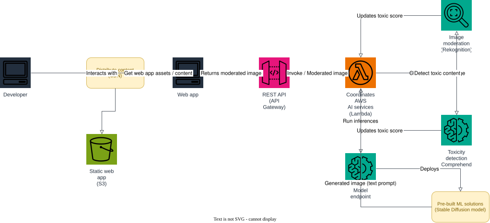

# AWS Project: Generative AI Content Moderator

This architecture lets a developer turn a text prompt into an AI-generated image while automatically screening both the prompt and the generated image for toxic or unsafe content before it is ever shown.

1. the developer opens the web app, delivered through a CDN (`Distribute content`) from the `Static web app` S3 bucket, which the web app uses to fetch its assets and content;
2. the web app sends an HTTP request with a prompt to create an image to the REST API (API Gateway);
3. the REST API invokes the `coordinator` Lambda (`Coordinates AWS AI services`);
4. the coordinator first calls **Toxicity detection** (Amazon Comprehend) to check the prompt for toxic content and update the running toxic score — a toxic prompt is blocked immediately;
5. the coordinator then invokes the `Model endpoint`, a pre-built ML solution running a Stable Diffusion model, to run inference and generate an image from the text prompt;
6. the coordinator calls **Image moderation** (Amazon Rekognition) to check the generated image and update the toxic score again — a flagged image is blocked;
7. the REST API returns the moderated image back through the web app to the developer.

## Prerequisites

- Docker
- Terraform 1.5+
- AWS CLI

## Start Floci

```bash
docker compose up -d
```

## Apply Terraform

```bash
terraform init
terraform apply
```

Applying:

- deploys the `toxicity-detection` Lambda (calls `comprehend.detect_toxic_content`) and the `image-moderation` Lambda (calls `rekognition.detect_moderation_labels`);
- deploys the `stable-diffusion` SageMaker model, endpoint configuration and endpoint — the pre-built ML solution's model endpoint;
- deploys the `coordinator` Lambda, which invokes both AI service Lambdas, calls the model endpoint, and updates the toxic score before returning a response;
- creates the REST API (API Gateway) with a `POST /generate` method proxied to the `coordinator` Lambda;
- renders [web/index.html.tftpl](web/index.html.tftpl) with the REST API's invoke URL and uploads it to the `static-web-app` bucket, distributed through CloudFront.

## Architecture



The diagram source is a real, editable [draw.io](https://www.drawio.com/) file at [docs/architecture.drawio](docs/architecture.drawio), generated programmatically with the [drawpyo](https://github.com/MerrimanInd/drawpyo) Python library. Open the `.drawio` file directly on GitHub or with the draw.io desktop app / [app.diagrams.net](https://app.diagrams.net/) to edit it.

To regenerate the diagram (`.drawio` source + the `.svg`/`.png` embedded above) after changing the architecture:

```bash
python3 -m venv .diagram-venv
.diagram-venv/bin/pip install drawpyo
.diagram-venv/bin/python scripts/generate_diagram.py

# rasterize the .drawio file to svg/png (used by the README) via headless draw.io
docker run --rm -v "$PWD/docs":/data -w /data rlespinasse/drawio-export -f svg -o . --output-mode relative --remove-page-suffix .
docker run --rm -v "$PWD/docs":/data -w /data rlespinasse/drawio-export -f png -o . --output-mode relative --remove-page-suffix -t .
```

## Request a moderated, generated image

```bash
API_URL=$(terraform output -raw generate_api_endpoint)

curl -s -X POST "$API_URL" \
  -H "Content-Type: application/json" \
  -d '{"prompt": "a watercolor painting of a mountain lake at sunrise"}' | jq
```

A blocked prompt (toxic text or an unsafe generated image) returns a `422` response with `"blocked": true`, the `reason` (`toxic_prompt` or `unsafe_image`), and the `toxic_score` that triggered the block. A clean request returns `"blocked": false` along with `image_base64`, the base64-encoded generated image.

## Open the web app

```bash
open "https://$(terraform output -raw cloudfront_domain_name)"
```

If you want to follow the execution, watch the Floci container logs:

```bash
docker compose logs -f floci
```

## Clean up

```bash
terraform destroy
docker compose down
```
